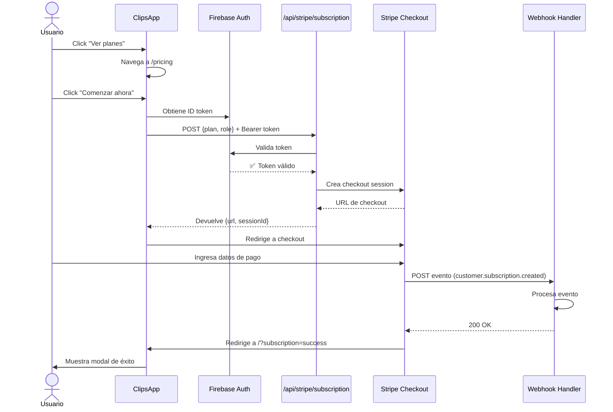

# 🎯 Funcionalidad de Suscripción Stripe - Guía Completa

## 📋 Resumen Ejecutivo

Se ha implementado un sistema completo de suscripción con Stripe para ClipsApp con:
- **4 planes de suscripción**: Business (mensual/anual) + Enterprise (mensual/anual)
- **Página dedicada** en `/pricing` con vista responsiva
- **Integración OAuth** con Firebase Authentication
- **Manejo de webhooks** para eventos de suscripción
- **Interfaz de usuario** moderna con Tailwind CSS

---

## 🏗️ Arquitectura

### Componentes Creados

#### 1. **Endpoint de API** - `/api/stripe/subscription`
**Archivo:** `src/routes/api/stripe/subscription.ts`

Funcionalidades:
- ✅ Autentica usando Firebase ID tokens
- ✅ Crea sesiones de checkout de Stripe
- ✅ Maneja webhooks de eventos de suscripción
- ✅ Routing automático: detecta webhooks por header `stripe-signature`

**Métodos HTTP:**
- `POST /api/stripe/subscription` → Crea sesión de checkout
  ```json
  {
    "plan": "monthly" | "annual",
    "role": "business" | "enterprise"
  }
  ```
  Respuesta:
  ```json
  {
    "url": "https://checkout.stripe.com/...",
    "sessionId": "cs_...",
    "plan": "monthly",
    "role": "business",
    "amount": 29.99,
    "currency": "usd"
  }
  ```

#### 2. **Página de Pricing** - `/pricing`
**Archivo:** `src/routes/pricing.tsx`

- ✅ Renderiza el componente `SubscriptionPlans`
- ✅ Detecta parámetros de URL: `subscription=success` / `subscription=cancelled`
- ✅ Muestra modales de confirmación

#### 3. **Componente UI** - `subscription-plans.tsx`
**Archivo:** `src/components/subscription-plans.tsx`

**Subcomponentes:**
- `SubscriptionPlans()` - Grid de 4 planes
- `SubscriptionCard()` - Tarjeta individual con características
- `SubscriptionSuccessModal()` - Modal de éxito
- `SubscriptionCancelledModal()` - Modal de cancelación

**Características visuales:**
- Diseño responsivo (1-4 columnas según viewport)
- Planes destacados con gradiente cyan→mint
- Iconos de verificación para características
- Loading state con spinner
- Validación de autenticación

#### 4. **Enlace de Navegación**
**Archivo:** `src/components/screens.tsx`

Agregado en el menu de perfil:
- Botón "Ver planes de suscripción" antes de "Cerrar sesión"
- Estilo: Borde y fondo cyan con hover effect
- Accesible desde cualquier pantalla autenticada

---

## 💰 Planes de Suscripción

### Business Plan
**Para creadores y pequeños negocios**

| Facturación | Precio | Características |
|------------|---------|-----------------|
| **Mensual** | $29.99/mes | • 10 clips/mes<br>• Analytics básicos<br>• Soporte por email<br>• Badge verificado |
| **Anual** | $299.90/año | • Mismo contenido<br>• Soporte prioritario<br>• Ahorro 17% |

### Enterprise Plan
**Para empresas y agencias**

| Facturación | Precio | Características |
|------------|---------|-----------------|
| **Mensual** | $99.99/mes | • Clips ilimitados<br>• Analytics avanzados<br>• Soporte 24/7<br>• API access<br>• Team management<br>• Custom branding |
| **Anual** | $999.90/año | • Mismo contenido<br>• Descuento 17%<br>• Consultoría incluida |

---

## 🔧 Configuración Requerida

### Variables de Entorno (Vercel)

Agregar en la sección Environment Variables del dashboard de Vercel:

```env
# Stripe Keys - Obtener de https://dashboard.stripe.com/apikeys
STRIPE_SECRET_KEY=sk_live_... (o sk_test_... para testing)
STRIPE_PUBLISHABLE_KEY=pk_live_... (o pk_test_...)
STRIPE_WEBHOOK_SECRET=whsec_...
```

### Webhook en Stripe Dashboard

1. Ir a: https://dashboard.stripe.com/webhooks
2. Crear nuevo endpoint:
   - **URL:** `https://tu-dominio.com/api/stripe/subscription`
   - **Eventos:**
     - `customer.subscription.created`
     - `customer.subscription.updated`
     - `customer.subscription.deleted`
     - `invoice.payment_succeeded`
     - `invoice.payment_failed`
3. Copiar el "Signing Secret" y guardar en `STRIPE_WEBHOOK_SECRET`

### Productos en Stripe

Los planes usan `price_data` inline, pero puedes crear productos en Stripe:

**Crear 4 precios (uno para cada plan):**
- `price_business_monthly` - $29.99/mes, recurrente
- `price_business_annual` - $299.90/año, recurrente
- `price_enterprise_monthly` - $99.99/mes, recurrente
- `price_enterprise_annual` - $999.90/año, recurrente

---

## 🔄 Flujo de Suscripción



---

## 🧪 Testing Local

### Verificar que todo está conectado:

```bash
# 1. Verifica que la página carga
curl http://localhost:8080/pricing

# 2. Verifica que el endpoint existe
curl -X POST http://localhost:8080/api/stripe/subscription \
  -H "Content-Type: application/json" \
  -d '{"plan":"monthly","role":"business"}'
# Espera: { "error": "..." } (sin 404)

# 3. Con autenticación (reemplaza TOKEN)
curl -X POST http://localhost:8080/api/stripe/subscription \
  -H "Content-Type: application/json" \
  -H "Authorization: Bearer <FIREBASE_ID_TOKEN>" \
  -d '{"plan":"monthly","role":"business"}'
# Espera: { "url": "https://checkout.stripe.com/...", ... }
```

### Testing en Stripe Dashboard

Usar **Modo de Prueba** (Test Mode):
1. Generar tarjetas de prueba: https://stripe.com/docs/testing
2. Tarjetas útiles:
   - `4242 4242 4242 4242` - Éxito
   - `4000 0000 0000 0002` - Fallar autenticación
   - `4000 0000 0000 0069` - Expirada

---

## 📊 Webhooks - Eventos Manejados

### `customer.subscription.created`
Enviado cuando se crea una nueva suscripción.
```typescript
// Log actual:
console.log(`[stripe] Subscription customer.subscription.created:`, subscription.id);
// TODO: Guardar en Firestore user.subscriptions colección
```

### `customer.subscription.updated`
Enviado cuando cambia el plan o se renueva.
```typescript
// TODO: Actualizar status en Firestore
```

### `customer.subscription.deleted`
Enviado cuando se cancela.
```typescript
// TODO: Marcar como cancelled en Firestore
```

### `invoice.payment_succeeded`
Enviado cuando se paga exitosamente.
```typescript
// TODO: Log de pago, actualizar fecha de próximo ciclo
```

### `invoice.payment_failed`
Enviado cuando falla un pago.
```typescript
// TODO: Notificar al usuario, marcar como deuda
```

---

## 🚀 Próximos Pasos (TODO)

### Fase 1: Persistencia de Datos
- [ ] Crear colección `subscriptions` en Firestore
- [ ] Guardar al recibir webhook `customer.subscription.created`
- [ ] Estructura:
  ```typescript
  {
    userId: string;
    stripeCustomerId: string;
    stripePriceId: string;
    plan: "monthly" | "annual";
    role: "business" | "enterprise";
    status: "active" | "past_due" | "cancelled";
    currentPeriodEnd: Timestamp;
    cancelAtPeriodEnd: boolean;
    createdAt: Timestamp;
  }
  ```

### Fase 2: Restricciones de Características
- [ ] Crear función `getUserSubscription()` en lib
- [ ] Gate features por plan:
  - Business: máximo 10 clips/mes
  - Enterprise: ilimitado
- [ ] Mostrar "Upgrade requerido" para features no disponibles
- [ ] Implementar contador de clips del mes

### Fase 3: Administración
- [ ] Página de administración: ver suscriptores activos
- [ ] Cancelar suscripción como admin
- [ ] Historial de pagos
- [ ] Reportes de ingresos

### Fase 4: Mejoras UX
- [ ] Email de confirmación de suscripción
- [ ] Recordatorio antes de renovación
- [ ] Portal del cliente (Stripe Customer Portal)
- [ ] Cambiar entre planes

---

## ⚙️ Archivo de Configuración

Ver `STRIPE_SETUP.md` para más detalles de configuración inicial.

---

## 🐛 Troubleshooting

### "Stripe not configured" (503 error)
**Causa:** Faltan variables de entorno
**Solución:** Verificar que `STRIPE_SECRET_KEY` esté definida en Vercel

### "No Firebase token" (401 error)
**Causa:** Usuario no autenticado
**Solución:** Debe iniciar sesión en la app antes de subscribirse

### Webhooks no se reciben
**Causa:** Endpoint URL incorrecta o webhook secret incorrecto
**Solución:** 
1. Verificar URL en Stripe Dashboard
2. Regenerar signing secret en Stripe
3. Actualizar `STRIPE_WEBHOOK_SECRET` en Vercel

### Checkout redirige a URL incorrecta
**Causa:** `origin` detectada incorrectamente
**Solución:** Verificar que el request incluye header `Origin` correcto

---

## 📚 Referencias

- [Stripe Checkout Session Docs](https://stripe.com/docs/api/checkout/sessions)
- [Stripe Webhooks](https://stripe.com/docs/webhooks)
- [Firebase ID Token Verification](https://firebase.google.com/docs/auth/admin/verify-id-tokens)
- [Firestore Security Rules](https://firebase.google.com/docs/firestore/security/start)

---

**Última actualización:** Noviembre 2026
**Estado:** ✅ Implementado y listo para configuración de producción
